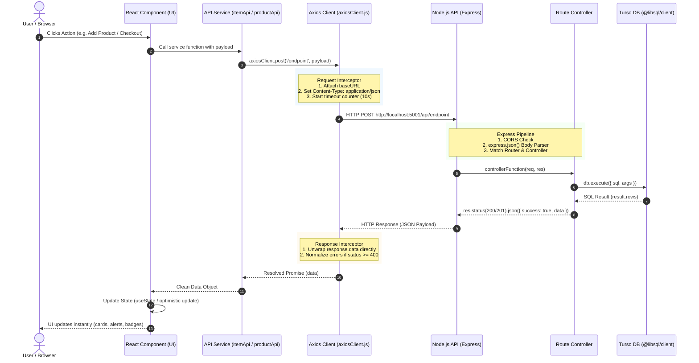
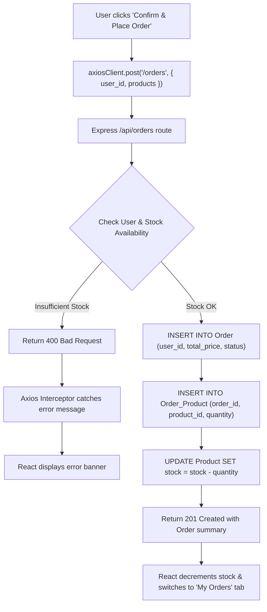

# Flow & Sample Axios Call Guide
## End-to-End Lifecycle: React ➜ Axios ➜ Express ➜ Turso DB

This document illustrates the complete journey of an HTTP call using **Axios** in this project—from the user clicking a button in React, through interceptors and the Express API server, down to the Turso SQLite database, and back to the UI.

---

## 1. High-Level Architecture Flow



---

## 2. The 3-Tier Client Architecture

To keep the frontend scalable and clean, Axios calls are structured into three distinct layers:

| Layer | File Example | Responsibility |
| :--- | :--- | :--- |
| **1. Configuration Layer** | [`client/src/api/axiosClient.js`](./client/src/api/axiosClient.js) | Central base URL, timeouts, global request/response interceptors. |
| **2. Service Layer** | [`client/src/api/productApi.js`](./client/src/api/productApi.js) | Semantic functions (`getProducts`, `createProduct`, `createOrder`). |
| **3. Presentation Layer** | [`client/src/App.jsx`](./client/src/App.jsx) | React UI components calling services, managing state, and handling UI feedback. |

---

## 3. Concrete Sample Flows

---

### Flow 1: Reading Data (`GET /api/products`)

When the React app mounts, it fetches all products from Turso to display in the catalog.

#### 1. React Component Trigger (`useEffect`)
```jsx
// client/src/App.jsx
useEffect(() => {
  const loadCatalog = async () => {
    setIsLoading(true);
    try {
      const data = await getProducts(); // ➜ Calls Service Layer
      setProducts(data);               // ➜ Updates React State
    } catch (err) {
      showAlert("error", err.message);
    } finally {
      setIsLoading(false);
    }
  };

  loadCatalog();
}, []);
```

#### 2. Service Layer Function
```javascript
// client/src/api/productApi.js
export const getProducts = async () => {
  const response = await axiosClient.get("/products");
  return response.data; // Array of product objects
};
```

#### 3. Central Axios Instance with Interceptor
```javascript
// client/src/api/axiosClient.js
const axiosClient = axios.create({
  baseURL: import.meta.env.VITE_API_BASE_URL || "http://localhost:5001/api",
  timeout: 10000,
});

// Interceptor automatically extracts response.data:
axiosClient.interceptors.response.use(
  (response) => response.data,
  (error) => Promise.reject(new Error(error.response?.data?.error || error.message))
);
```

#### 4. Express Server & Turso Execution
```javascript
// server/src/controllers/productController.js
export async function getProducts(req, res) {
  try {
    const result = await db.execute("SELECT * FROM Product ORDER BY id DESC");
    return res.status(200).json({
      success: true,
      data: result.rows,
    });
  } catch (error) {
    return res.status(500).json({ success: false, error: error.message });
  }
}
```

---

### Flow 2: Creating a Product (`POST /api/products`)

When the user fills in the form and clicks "Add Product".

#### 1. React Form Submission
```jsx
// client/src/components/ProductForm.jsx -> onSubmit handler in App.jsx
const handleProductSubmit = async (formData) => {
  setIsSubmitting(true);
  try {
    const newProduct = await createProduct(formData); // ➜ Calls Service Layer
    setProducts((prev) => [newProduct, ...prev]);      // ➜ Immediate UI append
    showAlert("success", `Product "${newProduct.name}" created!`);
  } catch (err) {
    showAlert("error", err.message);
  } finally {
    setIsSubmitting(false);
  }
};
```

#### 2. Service Layer Call
```javascript
// client/src/api/productApi.js
export const createProduct = async (productData) => {
  // Axios automatically converts productData to a JSON string
  // and sends header: 'Content-Type: application/json'
  const response = await axiosClient.post("/products", productData);
  return response.data;
};
```

#### 3. Express Controller with Parameterized SQL
```javascript
// server/src/controllers/productController.js
export async function createProduct(req, res) {
  const { name, price, category, stock, description, image_url } = req.body;

  // Safe parameterized query via @libsql/client:
  const result = await db.execute({
    sql: `INSERT INTO Product (name, price, category, stock, description, image_url)
          VALUES (?, ?, ?, ?, ?, ?) RETURNING *`,
    args: [name, price, category, stock, description, image_url],
  });

  return res.status(201).json({
    success: true,
    data: result.rows[0],
  });
}
```

---

### Flow 3: Placing an Order / Checkout (`POST /api/orders`)

A multi-entity transaction that connects `User`, `Product`, `Order`, and `Order_Product` while deducting stock.



#### 1. React Cart Checkout Trigger
```jsx
// client/src/components/CartModal.jsx
const handleCheckout = async () => {
  const orderPayload = {
    user_id: currentUser.id,
    products: cart.map((item) => ({
      product_id: item.id,
      quantity: item.quantity,
    })),
  };

  const newOrder = await createOrder(orderPayload); // ➜ Calls Service
  setOrders((prev) => [newOrder, ...prev]);
  setCart([]); // Clear cart
  setActiveTab("orders"); // Switch view
};
```

#### 2. Service Layer Call
```javascript
// client/src/api/orderApi.js
export const createOrder = async ({ user_id, products }) => {
  const response = await axiosClient.post("/orders", { user_id, products });
  return response.data;
};
```

---

### Flow 4: User Authentication & Switcher (`POST /api/auth/login`)

#### 1. Login Request
```javascript
// client/src/api/authApi.js
export const login = async ({ email, password }) => {
  const response = await axiosClient.post("/auth/login", { email, password });
  return response.data; // Returns user object without password
};
```

#### 2. Controller Validation in Express
```javascript
// server/src/controllers/userController.js
export async function loginUser(req, res) {
  const { email, password } = req.body;

  const result = await db.execute({
    sql: "SELECT id, name, email, password, role, status FROM `User` WHERE email = ?",
    args: [email.toLowerCase()],
  });

  const user = result.rows[0];
  if (!user || user.password !== password) {
    return res.status(401).json({ success: false, error: "Invalid credentials" });
  }

  const { password: _, ...safeUser } = user;
  return res.status(200).json({ success: true, data: safeUser });
}
```

---

## 4. Error Handling Lifecycle in Axios

When an error happens (e.g., server offline, 400 validation error, 404 not found, or 409 email already registered), Axios handles it through its **Response Interceptor**:

```javascript
// client/src/api/axiosClient.js
axiosClient.interceptors.response.use(
  (response) => {
    // Returns data payload directly if HTTP status is 2xx
    return response.data;
  },
  (error) => {
    // Intercepts HTTP status 4xx and 5xx or network drops
    const errorMessage =
      error.response?.data?.error ||   // Backend custom error message
      error.response?.data?.message || // Express standard message
      (error.code === "ECONNABORTED" ? "Request timeout. Server took too long." : null) ||
      error.message ||
      "An unexpected network error occurred.";

    // Normalizes into a standard JavaScript Error
    return Promise.reject(new Error(errorMessage));
  }
);
```

### In the React Component:
```jsx
try {
  await createProduct(payload);
} catch (err) {
  // err.message contains the clean, human-readable error from the backend!
  showAlert("error", err.message);
}
```

---

## 5. Comparison: Raw `fetch()` vs Modular `Axios`

| Feature | Raw `fetch()` | This Project's `Axios` Architecture |
| :--- | :--- | :--- |
| **Base URL** | Must repeat `http://localhost:5001/api` everywhere | Configured once in `axiosClient.js` |
| **JSON Serialization** | Must manually call `JSON.stringify(body)` | Handled automatically |
| **Response Parsing** | Must manually call `await response.json()` | Handled automatically by response interceptor |
| **HTTP Error Status** | Does **NOT** throw on 404 or 500 (requires manual `!res.ok` check) | Automatically rejects promise and invokes error interceptor |
| **Request Timeout** | Requires complex `AbortController` setup | Native configuration: `timeout: 10000` |
| **Error Normalization** | Inconsistent across components | Standardized in single response interceptor |

---

## 6. Testing Endpoints Directly

You can test any of these Axios endpoints directly from your terminal using `curl`:

```bash
# 1. Health check
curl -s http://localhost:5001/api/health

# 2. List all products
curl -s http://localhost:5001/api/products

# 3. Create a product
curl -s -X POST http://localhost:5001/api/products \
  -H "Content-Type: application/json" \
  -d '{"name":"TypeScript Book","price":29.99,"category":"Books","stock":10}'

# 4. Login
curl -s -X POST http://localhost:5001/api/auth/login \
  -H "Content-Type: application/json" \
  -d '{"email":"admin@dumetschool.com","password":"secret123"}'

# 5. Place an order
curl -s -X POST http://localhost:5001/api/orders \
  -H "Content-Type: application/json" \
  -d '{"user_id":4,"products":[{"product_id":5,"quantity":1}]}'
```

