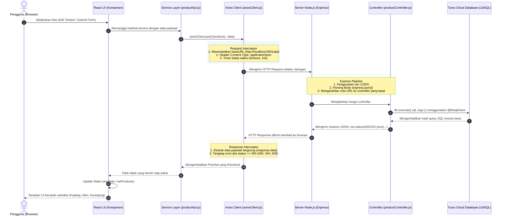
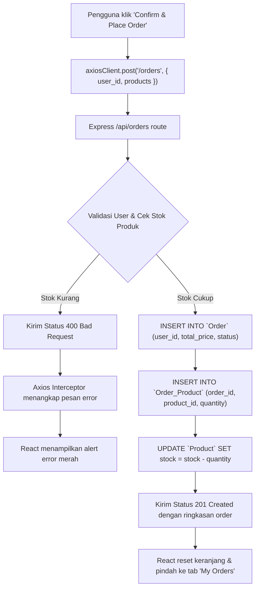

# Panduan Alur Panggilan Axios & Integrasi Full-Stack
## React ➜ Axios ➜ Node.js (Express) ➜ Turso SQL Database

Dokumen ini menjelaskan secara menyeluruh bagaimana data mengalir dalam arsitektur Full-Stack modern: mulai dari aksi pengguna di UI **React**, diproses oleh library HTTP **Axios**, diterima oleh server **Node.js (Express)**, disimpan ke cloud database **Turso (LibSQL)**, hingga kembali diperbarui di layar pengguna. 

Di bagian akhir, tersedia pula **panduan dasar penggunaan Axios pada Vanilla JavaScript (HTML + JS biasa)** sebagai fondasi pembelajaran.

---

## 1. Diagram Alur Siklus Hidup (End-to-End)



---

## 2. Arsitektur 3-Tier di Sisi React + Axios

Agar kode frontend rapi, mudah dirawat (*maintainable*), dan tidak berantakan, pemanggilan Axios dibagi menjadi **3 lapisan (tier)**:

```text
React Component (UI & State)
       │
       ▼  (Memanggil fungsi semantik, misal: getProducts())
API Service Layer (productApi.js, orderApi.js)
       │
       ▼  (Menggunakan instance terpusat, misal: axiosClient.get())
Axios Client Instance (axiosClient.js dengan BaseURL & Interceptors)
```

| Lapisan | File | Tanggung Jawab Utama |
| :--- | :--- | :--- |
| **1. Configuration Layer** | [`client/src/api/axiosClient.js`](./client/src/api/axiosClient.js) | Mengatur Base URL dari `.env`, header default, batas waktu timeout (10 detik), dan interceptor global untuk error handling. |
| **2. Service Layer** | [`client/src/api/productApi.js`](./client/src/api/productApi.js) | Menyediakan fungsi-fungsi spesifik API (`getProducts`, `createProduct`, `deleteProduct`). Komponen tidak perlu menulis URL HTTP secara manual. |
| **3. Presentation Layer** | [`client/src/App.jsx`](./client/src/App.jsx) | Mengelola state React (`useState`, `useEffect`), memanggil service layer, menampilkan indikator loading spinner, dan menampilkan pesan notifikasi. |

---

## 3. Penjelasan Alur Nyata Langkah-demi-Langkah

### Alur 1: Mengambil Data Produk (`GET /api/products`)

Ketika aplikasi web dibuka pertama kali di browser:

1. **Komponen React (`App.jsx`)**:
   Hook `useEffect` dijalankan saat komponen pertama kali di-mount (*render awal*).
   ```jsx
   useEffect(() => {
     const fetchKatalog = async () => {
       setIsLoading(true);
       try {
         // 1. Panggil service layer
         const data = await getProducts();
         // 2. Simpan hasil data ke state React
         setProducts(data);
       } catch (err) {
         showAlert("error", err.message);
       } finally {
         setIsLoading(false);
       }
     };

     fetchKatalog();
   }, []);
   ```

2. **Service Layer (`productApi.js`)**:
   Meneruskan permintaan ke `axiosClient` dengan endpoint `/products`.
   ```javascript
   export const getProducts = async () => {
     const response = await axiosClient.get("/products");
     return response.data; // Mengembalikan array produk
   };
   ```

3. **Axios Client & Interceptor (`axiosClient.js`)**:
   Menggabungkan `baseURL` (`http://localhost:5001/api`) + `/products` menjadi `http://localhost:5001/api/products` dan mengirim permintaan `HTTP GET`.

4. **Node.js Express Controller (`productController.js`)**:
   Menerima request dan menjalankan query SQL ke Turso:
   ```javascript
   export async function getProducts(req, res) {
     try {
       const result = await db.execute("SELECT * FROM Product ORDER BY id DESC");
       return res.status(200).json({
         success: true,
         data: result.rows,
       });
     } catch (error) {
       return res.status(500).json({ success: false, error: "Gagal mengambil data produk" });
     }
   }
   ```

5. **Turso Database**:
   Mengeksekusi SQL di cloud engine dan mengembalikan baris data tabel `Product`.

6. **Respons Kembali ke React**:
   Axios Interceptor menangkap respons sukses dan membuka wrapper `response.data`. Komponen React memperbarui state `setProducts()`, sehingga daftar produk langsung muncul di layar.

---

### Alur 2: Menambah Produk Baru (`POST /api/products`)

Ketika admin mengisi form produk baru dan menekan tombol **"Add Product"**:

1. **Form Submit di React (`ProductForm.jsx` ➜ `App.jsx`)**:
   ```jsx
   const handleProductSubmit = async (formData) => {
     setIsSubmitting(true);
     try {
       // Panggil service createProduct
       const newProduct = await createProduct(formData);
       // Tambahkan langsung ke daftar produk (optimistic/immediate state update)
       setProducts((prev) => [newProduct, ...prev]);
       showAlert("success", `Produk "${newProduct.name}" berhasil disimpan ke Turso!`);
     } catch (err) {
       showAlert("error", err.message);
     } finally {
       setIsSubmitting(false);
     }
   };
   ```

2. **Service Layer (`productApi.js`)**:
   ```javascript
   export const createProduct = async (productData) => {
     // Axios otomatis mengubah objek JavaScript menjadi JSON (JSON.stringify otomatis)
     const response = await axiosClient.post("/products", productData);
     return response.data;
   };
   ```

3. **Backend Express Controller (`productController.js`)**:
   Menggunakan parameter SQL aman (*parameterized query*) untuk mencegah SQL Injection:
   ```javascript
   export async function createProduct(req, res) {
     const { name, price, category, stock, description, image_url } = req.body;

     // Parameterized insert ke tabel Product di Turso
     const result = await db.execute({
       sql: `INSERT INTO Product (name, price, category, stock, description, image_url)
             VALUES (?, ?, ?, ?, ?, ?) RETURNING *`,
       args: [name, price, category, stock, description, image_url],
     });

     return res.status(201).json({
       success: true,
       data: result.rows[0],
     });
   }
   ```

---

### Alur 3: Melakukan Transaksi Checkout / Order (`POST /api/orders`)

Operasi multi-tabel yang melibatkan relasi `User`, `Product`, `Order`, dan `Order_Product`:



1. **React Cart Modal**:
   ```jsx
   const handleCheckout = async () => {
     const orderPayload = {
       user_id: currentUser.id,
       products: cart.map((item) => ({
         product_id: item.id,
         quantity: item.quantity,
       })),
     };

     const newOrder = await createOrder(orderPayload);
     // Kurangi stok di state lokal dan kosongkan keranjang
     setOrders((prev) => [newOrder, ...prev]);
     setCart([]);
     setActiveTab("orders");
   };
   ```

2. **Backend Controller (`orderController.js`)**:
   - Memastikan `user_id` terdaftar.
   - Memastikan stok produk mencukupi sebelum checkout.
   - Menghitung total harga belanja secara otomatis dari harga produk database.
   - Menyimpan ke tabel `Order`.
   - Menyimpan rincian ke tabel relasi `Order_Product`.
   - Mengurangi kuota stok di tabel `Product` (`UPDATE Product SET stock = stock - ?`).

---

## 4. Sistem Error Handling & Interceptor

Keunggulan utama Axios adalah **Response Interceptor**. Kita tidak perlu menulis pengecekan status error `if (!response.ok)` di setiap komponen:

```javascript
// client/src/api/axiosClient.js
axiosClient.interceptors.response.use(
  (response) => {
    // Jika status HTTP 200 - 299: langsung loloskan data bersih
    return response.data;
  },
  (error) => {
    // Jika status HTTP 4xx, 5xx, atau koneksi terputus:
    const customMessage =
      error.response?.data?.error ||   // Pesan error dari backend controller
      error.response?.data?.message || // Pesan error bawaan Express
      (error.code === "ECONNABORTED" ? "Koneksi timeout, server lambat merespons." : null) ||
      error.message ||
      "Terjadi kendala jaringan.";

    // Bungkus menjadi Error standar JavaScript agar bisa ditangkap oleh blok catch()
    return Promise.reject(new Error(customMessage));
  }
);
```

Dengan konfigurasi ini, di komponen React kita cukup menggunakan `try...catch` sederhana:
```jsx
try {
  await createOrder(payload);
} catch (err) {
  // err.message otomatis berisi pesan ramah pengguna dari database/server!
  showAlert("error", err.message);
}
```

---

## 5. Contoh Dasar Penggunaan Axios di Vanilla JavaScript

Bagi siswa atau pengembang yang ingin memahami dasar Axios sebelum masuk ke React, berikut adalah contoh penggunaan Axios murni (**Vanilla JavaScript**) menggunakan HTML dan JS biasa.

### 5.1 Menghubungkan Axios via CDN
Tambahkan tag `<script>` berikut di dalam file HTML Anda:

```html
<!DOCTYPE html>
<html lang="id">
<head>
  <meta charset="UTF-8">
  <title>Belajar Axios Vanilla JS</title>
  <!-- Load Axios dari CDN resmi -->
  <script src="https://cdn.jsdelivr.net/npm/axios/dist/axios.min.js"></script>
</head>
<body>
  <h1>Demo Axios Vanilla JS</h1>
  <button id="btnFetch">Ambil Data Produk</button>
  <ul id="productList"></ul>

  <script src="app.js"></script>
</body>
</html>
```

---

### 5.2 Contoh 1: Mengambil Data (GET Request) dengan `then/catch`
```javascript
// app.js
const btnFetch = document.getElementById("btnFetch");
const productList = document.getElementById("productList");

btnFetch.addEventListener("click", () => {
  // Memanggil API server kita di port 5001
  axios.get("http://localhost:5001/api/products")
    .then((response) => {
      // Data respons otomatis sudah berbentuk objek JavaScript (tidak perlu .json())
      const products = response.data.data;
      
      // Render ke DOM HTML
      productList.innerHTML = products.map((item) => `
        <li>
          <strong>${item.name}</strong> - Rp ${item.price} (Stok: ${item.stock})
        </li>
      `).join("");
    })
    .catch((error) => {
      console.error("Gagal mengambil data:", error.message);
      alert("Terjadi kesalahan saat memuat produk!");
    });
});
```

---

### 5.3 Contoh 2: Mengambil Data (GET Request) dengan `async / await` (Modern Pattern)
```javascript
async function loadProducts() {
  try {
    const response = await axios.get("http://localhost:5001/api/products");
    console.log("Daftar Produk:", response.data.data);
    return response.data.data;
  } catch (error) {
    if (error.response) {
      // Server merespons dengan status selain 2xx (misal 404, 500)
      console.error("Error dari Server:", error.response.data);
    } else if (error.request) {
      // Request terkirim tapi tidak ada balasan (server mati/koneksi putus)
      console.error("Tidak ada respons dari server:", error.request);
    } else {
      console.error("Error Request:", error.message);
    }
  }
}
```

---

### 5.4 Contoh 3: Mengirim Data Baru (POST Request) dari Form HTML
```html
<form id="productForm">
  <input type="text" id="name" placeholder="Nama Produk" required />
  <input type="number" id="price" placeholder="Harga" required />
  <input type="number" id="stock" placeholder="Stok" value="10" />
  <button type="submit">Simpan Produk</button>
</form>
```

```javascript
const productForm = document.getElementById("productForm");

productForm.addEventListener("submit", async (e) => {
  e.preventDefault(); // Mencegah reload halaman

  // Siapkan data dari input form
  const newProductData = {
    name: document.getElementById("name").value,
    price: parseFloat(document.getElementById("price").value),
    stock: parseInt(document.getElementById("stock").value, 10),
    category: "General",
    description: "Dibuat dari Vanilla JS",
  };

  try {
    // Axios otomatis mengubah objek JavaScript menjadi JSON (Content-Type: application/json)
    const response = await axios.post("http://localhost:5001/api/products", newProductData);

    alert(`Sukses! Produk "${response.data.data.name}" tersimpan dengan ID: ${response.data.data.id}`);
    productForm.reset();
  } catch (error) {
    const errorMsg = error.response?.data?.error || error.message;
    alert("Gagal menyimpan produk: " + errorMsg);
  }
});
```

---

### 5.5 Contoh 4: Membuat Custom Instance (`axios.create`) di Vanilla JS
Jika memiliki banyak endpoint ke server yang sama, buat instance kustom agar tidak mengulang URL dasar:

```javascript
// Buat instance API terpusat
const api = axios.create({
  baseURL: "http://localhost:5001/api",
  timeout: 5000,
  headers: {
    "Content-Type": "application/json",
  },
});

// Pemanggilan menjadi sangat ringkas:
async function testApi() {
  // GET: http://localhost:5001/api/products
  const products = await api.get("/products");

  // POST: http://localhost:5001/api/auth/login
  const user = await api.post("/auth/login", {
    email: "admin@dumetschool.com",
    password: "secret123"
  });

  console.log("Login Sukses:", user.data);
}
```

---

## 6. Tabel Perbandingan: Native `fetch()` vs `Axios`

| Aspek | Native `fetch()` | Library `Axios` |
| :--- | :--- | :--- |
| **Instalasi** | Bawaan browser (tanpa install) | Perlu CDN atau `npm install axios` |
| **Konversi JSON Request** | Harus manual: `body: JSON.stringify(data)` | Otomatis: kirim objek langsung |
| **Parsing JSON Response** | Harus 2 langkah: `const res = await fetch(); const data = await res.json();` | Otomatis: data langsung siap di `response.data` |
| **Deteksi Error HTTP** | **Tidak melempar error** pada status 404/500 (harus cek manual `if (!res.ok)`) | **Otomatis melempar error** ke blok `catch()` pada status selain 2xx |
| **Interceptors** | Tidak tersedia secara native | Didukung penuh (`request` & `response` interceptor) |
| **Timeout Batas Waktu** | Rumit (perlu konfigurasi `AbortController`) | Sangat mudah (`timeout: 10000`) |
| **Base URL Global** | Harus ditulis lengkap di setiap pemanggilan | Cukup diset sekali lewat `axios.create({ baseURL })` |

---

## 7. Kesimpulan

1. **React** bertugas mengatur state dan tampilan antarmuka secara interaktif.
2. **Axios** bertindak sebagai kurir data yang andal, menyederhanakan serialization JSON, menangani timeout, dan menyediakan penanganan error global lewat *interceptors*.
3. **Node.js (Express)** menjadi gerbang pengaman logika bisnis dan validasi input.
4. **Turso (LibSQL)** menyediakan penyimpanan SQLite serverless terdistribusi berkecepatan tinggi yang aman terhadap SQL injection melalui query berparameter.

### 5.5 Contoh 4: Membuat Custom Instance (`axios.create`) di Vanilla JS
Jika memiliki banyak endpoint ke server yang sama, buat instance kustom agar tidak mengulang URL dasar:

```javascript
// Buat instance API terpusat
const api = axios.create({
  baseURL: "http://localhost:5001/api",
  timeout: 5000,
  headers: {
    "Content-Type": "application/json",
  },
});

// Pemanggilan menjadi sangat ringkas:
async function testApi() {
  // GET: http://localhost:5001/api/products
  const products = await api.get("/products");

  // POST: http://localhost:5001/api/auth/login
  const user = await api.post("/auth/login", {
    email: "admin@dumetschool.com",
    password: "secret123"
  });

  console.log("Login Sukses:", user.data);
}
```

---

## 6. Tabel Perbandingan: Native `fetch()` vs `Axios`

| Aspek | Native `fetch()` | Library `Axios` |
| :--- | :--- | :--- |
| **Instalasi** | Bawaan browser (tanpa install) | Perlu CDN atau `npm install axios` |
| **Konversi JSON Request** | Harus manual: `body: JSON.stringify(data)` | Otomatis: kirim objek langsung |
| **Parsing JSON Response** | Harus 2 langkah: `const res = await fetch(); const data = await res.json();` | Otomatis: data langsung siap di `response.data` |
| **Deteksi Error HTTP** | **Tidak melempar error** pada status 404/500 (harus cek manual `if (!res.ok)`) | **Otomatis melempar error** ke blok `catch()` pada status selain 2xx |
| **Interceptors** | Tidak tersedia secara native | Didukung penuh (`request` & `response` interceptor) |
| **Timeout Batas Waktu** | Rumit (perlu konfigurasi `AbortController`) | Sangat mudah (`timeout: 10000`) |
| **Base URL Global** | Harus ditulis lengkap di setiap pemanggilan | Cukup diset sekali lewat `axios.create({ baseURL })` |

---

## 7. Kesimpulan

1. **React** bertugas mengatur state dan tampilan antarmuka secara interaktif.
2. **Axios** bertindak sebagai kurir data yang andal, menyederhanakan serialization JSON, menangani timeout, dan menyediakan penanganan error global lewat *interceptors*.
3. **Node.js (Express)** menjadi gerbang pengaman logika bisnis dan validasi input.
4. **Turso (LibSQL)** menyediakan penyimpanan SQLite serverless terdistribusi berkecepatan tinggi yang aman terhadap SQL injection melalui query berparameter.

